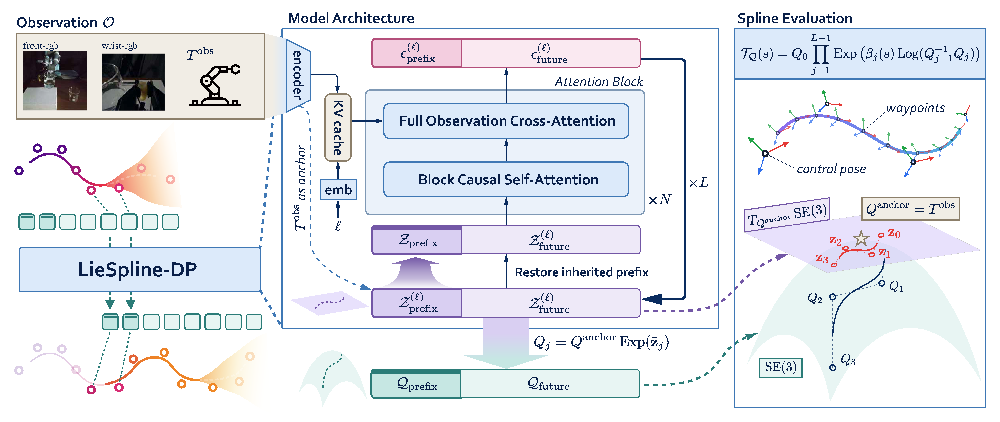

# LieSpline-DP

### Lie-Group B-Spline Diffusion Policy for Smooth Robot Manipulation

**Erxuan Xie\*, Bang Liu\*, Pingyun Nie, Xingkai Liu, Zhuang Fu, Bo Zhang**

[Paper (arXiv)](https://arxiv.org/abs/2609.15162v2) · [Installation](#installation) · [Quick start](#quick-start) · [Citation](#citation)

LieSpline-DP learns continuous end-effector trajectories on SE(3) with a
Lie-group B-spline action representation. Consecutive plans share boundary
control poses to maintain **C² continuity across action chunks**.



This repository provides implementations of LieSpline-DP for both simulation
and real-world robots, including training and inference.

## Installation

Linux, Conda and an NVIDIA GPU are recommended. The environment uses Python 3.10,
PyTorch 2.5.1 and CUDA 12.1. Run commands from the repository root.

```bash
git clone https://github.com/xieerxuan/LieSpline-DP.git
cd LieSpline-DP

conda env create -f conda_environment.yaml
conda activate liespline-dp
python -m pip install -e '.[simulation,robot]'

python -m robomimic.scripts.setup_macros
python -m robosuite.scripts.setup_macros
export MUJOCO_GL=egl
export PYOPENGL_PLATFORM=egl
```

Simulation requires OpenGL/EGL runtime libraries, Make and a C/C++ compiler.
The Conda environment includes CMake 3.x for building `egl_probe`.

## Quick start

Train and evaluate LieSpline-DP on the **Lift PH low-dimensional** dataset.

**1. Download and prepare demonstrations.**

```bash
python -m robomimic.scripts.download_datasets \
  --download_dir data/robomimic/datasets \
  --tasks lift \
  --dataset_types ph \
  --hdf5_types low_dim

python -m liespline_dp.scripts.robomimic_dataset_conversion \
  --task lift

python -m liespline_dp.scripts.robomimic_bspline_se3_dataset_conversion \
  --task_config liespline_dp/config/task/lift/bspline_se3_lowdim_abs.yaml
```

**2. Train.**

```bash
python train.py \
  --config-name=bspline_se3/train_lowdim_workspace \
  task=lift/bspline_se3_lowdim_abs \
  training.device=cuda:0 \
  training.resume=false \
  logging.mode=offline \
  hydra.run.dir=data/outputs/lift_liespline
```

Logs and checkpoints are saved to the selected output directory. W&B runs
locally in offline mode. Reduce `task.env_runner.n_envs` on smaller machines;
add `training.debug=true` for a short trial run.

**3. Evaluate.**

```bash
python eval.py \
  --checkpoint data/outputs/lift_liespline/checkpoints/latest.ckpt \
  --output_dir data/eval/lift_liespline \
  --device cuda:0
```

## Real-robot training and deployment

**Training:** collect synchronized images, measured robot states and target
commands; convert the recordings to a training cache and spline control points,
then train with `train_real_robot.py`. See the [training guide](docs/real_robot_training.md)
for the supported data format and commands.

**Deployment:** feed observations to the policy and execute the returned TCP
pose and gripper targets with your own controller or the provided service
client. Developers supply sensor acquisition and hardware execution. See the
[deployment guide](docs/real_robot_deployment.md) for the model interface,
continuous inference timing and hardware integration.

## Citation

If you use this work, please cite:

```bibtex
@misc{xie2026liesplinedpliegroupbsplinediffusion,
      title={LieSpline-DP: Lie-Group B-Spline Diffusion Policy for Smooth Robot Manipulation},
      author={Erxuan Xie and Bang Liu and Pingyun Nie and Xingkai Liu and Zhuang Fu and Bo Zhang},
      year={2026},
      eprint={2609.15162},
      archivePrefix={arXiv},
      primaryClass={cs.RO},
      url={https://arxiv.org/abs/2609.15162},
}
```

## Acknowledgments

Built on [Diffusion Policy](https://github.com/real-stanford/diffusion_policy),
[Robomimic](https://github.com/ARISE-Initiative/robomimic) and
[Robosuite](https://github.com/ARISE-Initiative/robosuite).

The [tensor utilities](liespline_dp/model/common/tensor_util.py) and
[crop randomizer](liespline_dp/model/vision/crop_randomizer.py) include code
derived from Robomimic. The [asynchronous vector environment](liespline_dp/gym_util/async_vector_env.py)
includes code derived from [Gym](https://github.com/openai/gym).
Code is released under the [MIT license](LICENSE), which includes the inherited
copyright notices. The [JPEG 2000 codec adapter](liespline_dp/codecs/imagecodecs_numcodecs.py)
retains its BSD notice; datasets retain their upstream terms.
